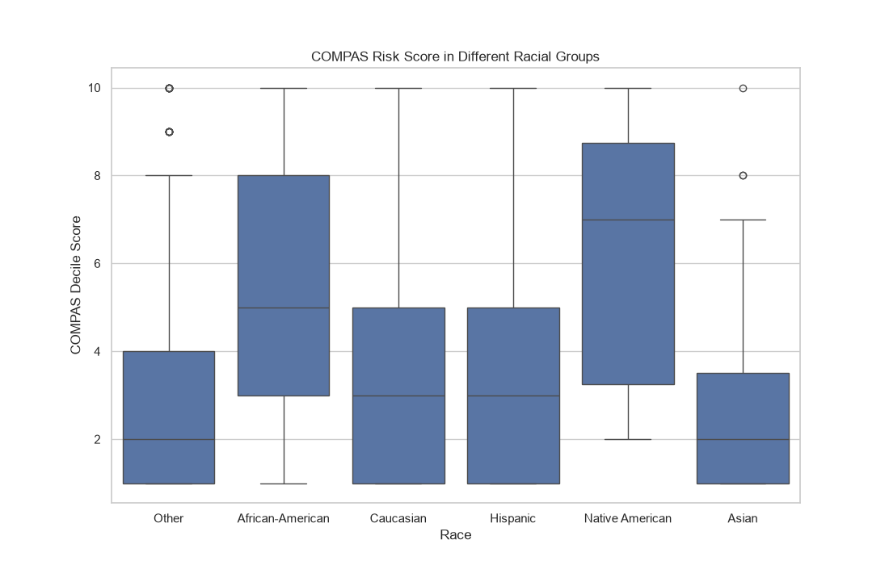
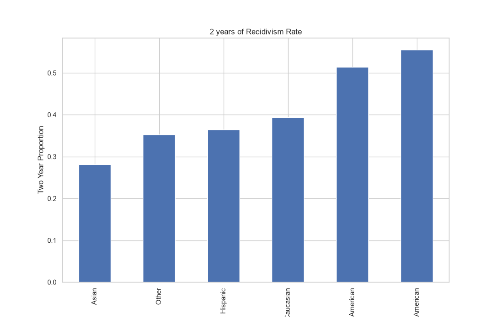
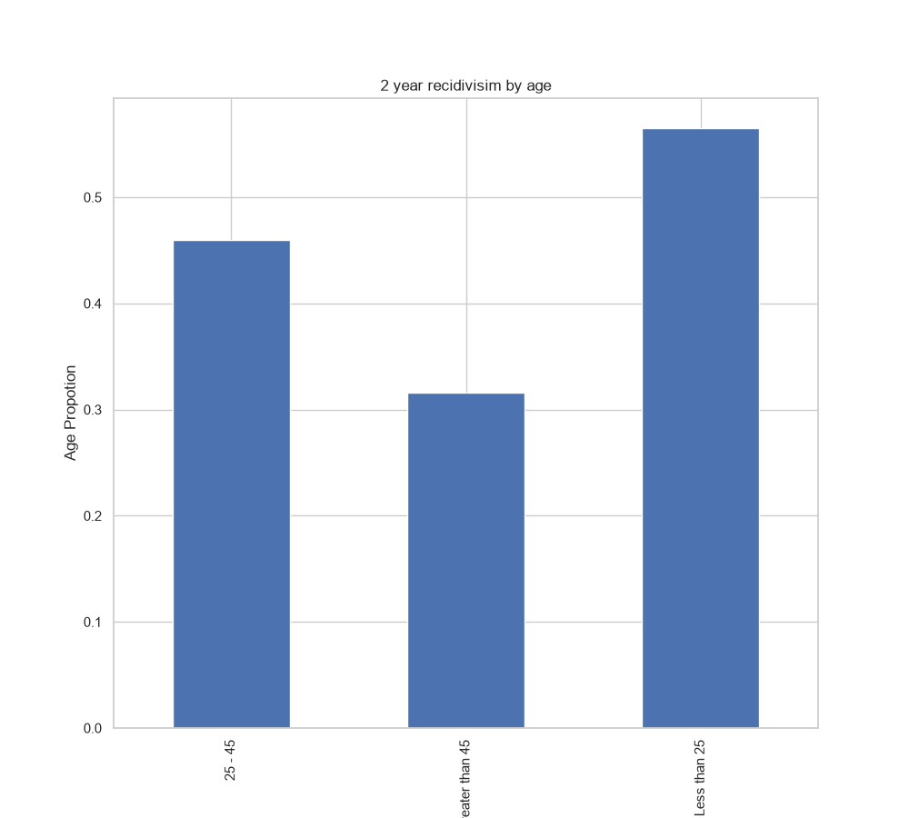

# Artificial Intellegience and Algorithmic Bias: EDA 

**Author:** Ekram Milash
**Course:** CSE163
**Date:** November 2026

**My Github:** https://github.com/ekrammi/cse163-compas-ai 

## Summary of Findings and Research Questions

In this project, i look through the COMPAS file to investigate differences in AI risk assessments in different groups of people across different age groups.

My research questions are:

1.Do different types of machine learning models have different types of errors across racial groups?

2. How does AI risk score differently across different groups?

3.Does someone’s age affect the accuracy of AI risk prediction?

Mainly this project uses teh COMPAS risk assessment, which is able then to estimate recidivism.

## 3. Datasets

This projects uses multiple datasets but the most important one is the COMPASS recidivism dataset 
- Contains over 7000 rows and around 53 columns

variable included are:
- 'age'
- 'race'
- 'sex'
- 'decile_score'
- two_year_recid'

It also includes other variables but this are the most important ones we are looking at.

## 4. Method
The dataset uses pandas, matplotlub, Seaborn to analyze the data. the Analysis assess missing values, examines numerical values and summarizes it, main difference in recidivism and more.

Moreover, the analuses uses visulaizations to identify common patterns in order to assess different risk scores and understand the potential recidivsim across race, and age groups.

## 5. EDA Results

Age
- Mean: 34.82
- standard deviation: 11.89
- minimum: 18
- Q1: 25
- Median: 31
- Q3: 42
- Maximum: 96

Two Year Recidivism
- Mean: 0.45
- standard deviation: 0.50
- minimum: 0
- Q1: 0
- Median: 0
- Q3: 1
- Maximum: 1

Decile Score
- Mean: 4.51
- standard deviation: 2.86
- minimum: 1
- Q1: 2
- Median: 4
- Q3: 7
- Maximum: 10

Racial Groups included:
- African Americans: 3696
- Hispanics: 637
- White: 2454
- Asians: 32
- Native Americans: 18
- others: 377

Age sections has around 1529 under 25, 1576 over 45 and 4109 between 25 - 45
Risk section has 3897 Low, 1914 medium and 1403 High.

## 6. Challenge Goals update

### Machine Learning and Artifical Intelligence
 the data has been uploaded and i was also abel to explore with visulizations done with python frameowkr.s in the next step, i will have to involve the training and also understanding the differences of the machine learning models

 ##$ Result Validity
 the EDA is able to identify the risk scores as well as the recidivism of the two years across different age groups and racial groups. 

In the visulizations we are able to see the different statistics and understand the different patterns. Moroever, we still do know if these visulizations are able to prove that age and race play a factor so there needs to be further exploratios and testing.

### 7. Work Plan Evaluation

My workplan includes understanding the dataset, clenaing it and creating the visulizations and i was able to do that with this project. 

I was able to obtain the data, load it and read the necessary information to create the statistics and visulizations. furthermore, i need to training and create the comparison.

### 8. Testing
There is a file in this directory that has test_eda.py/ which tests the dataset i have and wether it include the columns needed. The test was executed successfully and passed all the tests i wrote. 

### Collaboration
The project used COMPAS dataset  and analysis resources.
## Data Visulizations: Risk Score  by race

## Data Visulizations: Recidivism across race

## Data Visulizations: Recidivism by age

